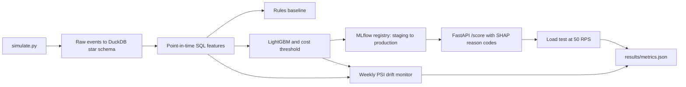

# Real-time payment fraud scoring

This project simulates card payments (it does not use a live transaction feed), builds point-in-time SQL features in DuckDB, and trains a LightGBM fraud model against hand-written amount, velocity, and new-device rules. The cost-based review threshold is chosen on the validation week only. The booster is promoted from Staging to Production in a local MLflow registry, scored through FastAPI with TreeSHAP reason codes, and watched by a weekly PSI monitor. Week 11 changes the fraud mix and routes every payment to one acquirer region so the monitor has a known shift to find.

## Setup

```text
python -m venv .venv
.venv\Scripts\pip install -r requirements.txt
```

Python 3.11 or 3.12. No paid APIs and no GPU. Training uses at most 4 threads.

## How to run

```text
python run.py
python run.py --quick
python run.py --device cpu
```

`python run.py` regenerates 3,000,000 simulated transactions, writes `results/`, and then runs the test suite with coverage. `--quick` is the same code path on 36,000 transactions and is what the smoke test calls. `--device cuda` is accepted and ignored; scoring stays on CPU.

Tests:

```text
python -m pytest --cov=src --cov-report=term-missing
```

## Architecture



## Design decisions

Out-of-time split: weeks 1-8 train, week 9 validation, weeks 10-12 test. `data/splits.json` is written before training. Rule thresholds are fit on training rows only. The review threshold minimizes `5 * false positives + 100 * false negatives` on validation scores only.

Feature SQL uses `RANGE ... 1 MICROSECOND PRECEDING` or `ROWS ... 1 PRECEDING`, so the current transaction and anything later are excluded. Merchant risk is the fraud rate of earlier transactions at that merchant over the previous 7 days. A lifetime count would rise every week and trip the drift rule on a stable book. Device reuse is the number of distinct customers seen on the device before this event. Tests compare a 5-row example to hand-computed values and append a future event to prove past features do not move.

The rules baseline is only high amount, 1-hour velocity, and new device combined with high amount. LightGBM also sees merchant risk and device reuse, which is where the lift should come from: mule purchases and shared-device fraud do not trip those rules.

Week 11 keeps the same fraud rate but moves the mix toward card testing and device farms. It also sets `acq_region` to 0 for every row. Other weeks spread region evenly across 0-4. That column is monitored and is not a model feature, so a routing change can trip PSI without rewriting the score. The reference window is validation week 9, the last week before the test period. An alert is PSI > 0.2 on any monitored feature or on the score.

The API loads the saved booster and returns LightGBM's probability plus the three largest TreeSHAP contributions (`pred_contrib`). A separate SHAP `TreeExplainer` pass writes the importance plot. The load test sends 50 requests per second to a local uvicorn process after a short warmup. The scoring process uses one thread because a single-row tree is faster that way. The latency file is `results/loadtest_latencies.csv`, and p95 is the 95th percentile of those client-observed times.

## Dataset

Transactions are simulated in `src/simulate.py` (MIT, this repository). The generator is in the spirit of PaySim and BankSim: entity ids, amounts, and injected fraud labels, produced locally rather than downloaded. The run writes `data/transactions.parquet`, a SHA-256 sidecar, and checks the checksum and row count before training. `data/` is git-ignored.

Patterns: card testing (small repeated amounts), account takeover (new device and a large amount), mule merchants (ordinary amounts at merchants that already have prior fraud), and device farms (many customers on a few devices). About 1.2% of rows are fraud. A small number of legitimate purchases sit on mule merchants, and about 4% of legitimate amounts are large bills, so amount alone is a weak rule.

## Results

Figures below are written by `python run.py` from `results/metrics.json`.

<!-- RESULTS:START -->
| Criterion | Value | Op | Threshold | Passed |
| --- | --- | --- | --- | --- |
| Test PR-AUC (weeks 10-12) | 0.9977917996038129 | >= | 0.6 | yes |
| Test PR-AUC lift vs rules baseline | 2.61655304547863 | >= | 1.5 | yes |
| Recall at 1% alert rate | 0.8262222222222222 | >= | 0.7 | yes |
| API p95 latency at 50 RPS | 4.343855008482933 | < | 50.0 | yes |
| Drift detection | 1.0 | >= | 1.0 | yes |
| Point-in-time correctness | 0.0 | <= | 0.0 | yes |
| Test coverage of src/ | 90.9982174688057 | >= | 80.0 | yes |

Headline figures stored in `metrics.headline`:

| Figure | Value |
| --- | --- |
| n_transactions | 3000000 |
| test_pr_auc | 0.9978 |
| pr_auc_lift | 2.62 |
| recall_at_1pct | 0.8262 |
| p95_ms | 4.34 |
| week_11_max_psi | 20.9958 |

All success criteria passed.
<!-- RESULTS:END -->

Plots: `results/pr_curve.png`, `results/shap_importance.png`, `results/drift_psi.png`, `results/score_by_week.png`.

Recompute from `results/test_predictions.csv` (`txn_id`, `week`, `day`, `y_true`, `model_score`, `baseline_score`):

- PR-AUC is `sklearn.metrics.average_precision_score`.
- Recall at 1% alert rate: for each `day`, take `k = max(1, floor(0.01 * n_day))` rows with the highest `model_score`, breaking ties by smaller `txn_id`. Recall is caught fraud divided by all fraud in the file.
- Lift is model PR-AUC divided by baseline PR-AUC on the same file.
- Drift PSI uses `results/drift_weekly.csv`. An alert week is any feature with PSI > 0.2. PSI is `sum (actual - reference) * ln(actual / reference)` after clipping empty bins to 1e-6 and renormalizing. Reference week is 9.

## Limitations

The transactions are simulated. Labels are available immediately; a real chargeback file would lag. Merchant risk therefore uses past labels with no delay. The patterns are intentionally separable, so the scores are not a forecast of live fraud performance. The latency number is a loopback benchmark on one machine, not a multi-host deployment. The API scores a feature vector that the warehouse has already computed; it does not rebuild SQL features inside the request.
