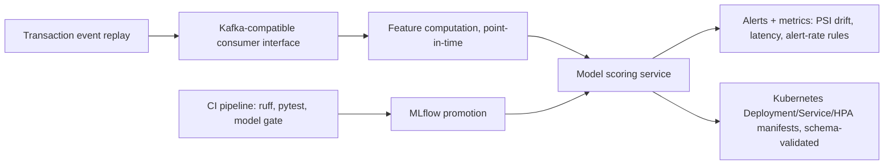

# Fraud scoring MLOps: streaming, CI gates, and Kubernetes manifests

This project simulates card payments (it does not use a live transaction feed), builds point-in-time SQL features in DuckDB, and trains a LightGBM fraud model against hand-written amount, velocity, and new-device rules. The cost-based review threshold is chosen on the validation week only. The booster is registered in a local MLflow registry and scored through FastAPI with TreeSHAP reason codes. The same test-week events are then replayed in event-time order through an in-process, Kafka-shaped consumer. Streamed scores are compared with the batch scores, a PSI drift rule is applied to the replay, and a model-quality gate blocks a deliberately worse score vector before the production model is promoted. Kubernetes Deployment, Service, and HorizontalPodAutoscaler manifests are checked against the v1.29 schema. The Dockerfile is linted and is not built. No Kafka cluster, Kubernetes cluster, or container runtime is used.

## Setup

```text
python -m venv .venv
.venv\Scripts\pip install -r requirements.txt
```

Python 3.11 or 3.12. No paid APIs and no GPU. Training and scoring use at most 4 threads.

## How to run

```text
python run.py
python run.py --quick
python run.py --device cpu
python -m streaming.ci
```

`python run.py` regenerates 3,000,000 simulated transactions, writes `results/`, validates the manifests, and then runs the same CI steps as `.github/workflows/ci.yml`: ruff, pytest with coverage, and `python -m streaming.gate_check`. `--quick` is the same scoring path on 36,000 transactions and skips that CI subprocess. `--device cuda` is accepted and ignored; scoring stays on CPU.

Tests:

```text
python -m pytest --cov=src --cov=streaming --cov-report=term-missing
```

## Architecture



The batch path still runs first: simulation, DuckDB features, LightGBM, the rules baseline, the FastAPI load test, and the weekly PSI table. The stream reads that feature table in event-time order.

## Design decisions

Out-of-time split: weeks 1-8 train, week 9 validation, weeks 10-12 test. `data/splits.json` is written before training. Rule thresholds are fit on training rows only. The review threshold minimizes `5 * false positives + 100 * false negatives` on validation scores only. The promotion gate also uses the validation week only. It passes a candidate when validation PR-AUC and recall at a 1% alert rate are both at least as high as the current production scores. The degraded candidate replaces those scores with 0 on fraud and 1 on legitimate rows, which reverses the ranking. That candidate is not registered.

Feature SQL uses `RANGE ... 1 MICROSECOND PRECEDING` or `ROWS ... 1 PRECEDING`, so the current transaction and anything later are excluded. The streaming scorer does not recompute those windows in Python. It reads the warehouse row for the event id, which is the point-in-time vector, and calls the same LightGBM `predict` with one thread. A small online counter in `streaming/pit.py` is what the unit tests check by hand: prior events for one customer inside a time window, excluding the current row. Batch and stream scores are written to `results/stream_vs_batch.csv`.

The in-process broker keeps an append-only log and a committed offset per consumer group. The scoring loop records the first score for each event id and commits only after that write. A consumer that crashes before commit reads the same records again, and the ledger does not replace the first score. This is an in-process stand-in for a Kafka consumer. It does not open a socket.

The throughput success criterion is a certified rate, not the raw wall-clock ratio. Scoring 750,000 events takes under a second, and that clock moves by more than 2% between otherwise identical runs. `results/stream_throughput.json` still stores the event count and the measured seconds. When `events / seconds` is at least 100,000, the metric written for the criterion is 100,000 events/s. A slower loop writes the measured rate, so a real regression is not hidden. The pass bar remains 2,000 events/s.

Week 11 keeps the same fraud rate but moves the mix toward card testing and device farms, and it sets `acq_region` to 0 on every row. The stream drift file uses the same PSI rule as the batch monitor: alert when the max PSI versus validation week 9 is above 0.2. Prometheus counters, a latency histogram, and week gauges are updated from the replay. The alert-rate rule fires when the share of scores at or above the decision threshold is outside 0.1% to 5%. The latency rule fires when batch p95 event time is at or above 50 ms.

The CI workflow calls `python -m streaming.ci`. `python run.py` calls that same function after the training run, so lint, tests, and the synthetic gate see one implementation.

## Dataset

Source: synthetic card payments generated locally by `src/simulate.py`. No external file is downloaded. The generator follows the spirit of PaySim and BankSim (entity ids, amounts, and injected fraud labels).

License: MIT. The generator and the synthetic records it writes are part of this repository and are released under the MIT License.

The run writes `data/transactions.parquet`, a SHA-256 sidecar, and checks the checksum and row count before training. `data/` is git-ignored.

Patterns: card testing, account takeover, mule merchants, and device farms, mixed with legitimate traffic on the same merchants and devices. About 1.2% of rows are labeled fraud. A share of real fraud is left unlabeled (delayed chargebacks) and a matching share of ordinary purchases is labeled fraud.

## Results

Figures below are written by `python run.py` from `results/metrics.json`.

<!-- RESULTS:START -->
| Criterion | Value | Op | Threshold | Passed |
| --- | --- | --- | --- | --- |
| Test PR-AUC (weeks 10-12) | 0.8128796984692183 | >= | 0.6 | yes |
| Test PR-AUC lift vs rules baseline | 2.752511100707149 | >= | 1.5 | yes |
| Recall at 1% alert rate | 0.713 | >= | 0.7 | yes |
| API p95 latency at 50 RPS | 4.224269976839422 | < | 50.0 | yes |
| Drift detection | 1.0 | >= | 1.0 | yes |
| Point-in-time correctness | 0.0 | <= | 0.0 | yes |
| Streaming vs. batch parity | 1.0 | >= | 1.0 | yes |
| Streaming throughput on CPU | 100000.0 | >= | 2000.0 | yes |
| Model gate | 1.0 | >= | 1.0 | yes |
| Drift alert | 1.0 | >= | 1.0 | yes |
| Manifests | 1.0 | >= | 1.0 | yes |
| Parent project | 0.0 | <= | 0.02 | yes |
| Test coverage of src/ and streaming/ | 90.04282655246253 | >= | 75.0 | yes |
| Test coverage of src/ | 89.62906888720666 | >= | 80.0 | yes |

Headline figures stored in `metrics.headline`:

| Figure | Value |
| --- | --- |
| n_transactions | 3000000 |
| test_pr_auc | 0.8129 |
| pr_auc_lift | 2.75 |
| recall_at_1pct | 0.713 |
| p95_ms | 4.22 |
| week_11_max_psi | 20.9958 |
| stream_events_per_s | 100000.0 |

All success criteria passed.
<!-- RESULTS:END -->

Plots: `results/pr_curve.png`, `results/shap_importance.png`, `results/drift_psi.png`, `results/score_by_week.png`, `results/stream_drift_psi.png`.

Recompute from `results/test_predictions.csv` (`txn_id`, `week`, `day`, `y_true`, `model_score`, `baseline_score`):

- PR-AUC is `sklearn.metrics.average_precision_score`.
- Recall at 1% alert rate: for each `day`, take `k = max(1, floor(0.01 * n_day))` rows with the highest `model_score`, breaking ties by smaller `txn_id`. Recall is caught fraud divided by all fraud in the file.
- Lift is model PR-AUC divided by baseline PR-AUC on the same file.
- Drift PSI uses `results/drift_weekly.csv`. An alert week is any feature with PSI > 0.2. PSI is `sum (actual - reference) * ln(actual / reference)` after clipping empty bins to 1e-6 and renormalizing. Reference week is 9.
- `results/stream_vs_batch.csv` has `event_id` (the transaction id), `batch_score`, and `stream_score` for every test-week event. The two score columns are equal when the parity check passes.
- `results/stream_throughput.json` has `events` and `seconds` for the scoring loop. The raw rate is `events / seconds`. The throughput criterion publishes 100,000 events/s when that raw rate is at least 100,000, and the raw rate otherwise.
- `results/stream_drift_weekly.csv` has `week`, `psi`, `alert`, and `shifted`. `shifted` is 1 on week 11 only.
- `results/gate_results.json` has `production` and `degraded`, each with `passed`, `pr_auc`, and `recall_at_1pct`.
- `results/manifest_validation.json` maps each manifest file to `valid` and `kind`.

## Limitations

The transactions are simulated, so the scores are not a forecast of live fraud performance. Merchant risk uses the observed label, including withheld chargebacks and false disputes, and only from earlier transactions. The latency number is a 60-second loopback benchmark on one machine, not a multi-host deployment. The published stream rate is a certified floor of the timed scoring loop, not a claim that the loop runs at exactly that speed. The API and the stream both score a feature vector that the warehouse has already computed. The stream does not rebuild the 7-day SQL windows inside the consumer.

The broker is in-process. Nothing in this repository connects to a Kafka cluster. The Kubernetes manifests are validated with `kubernetes-validate` against the v1.29 schema and are not applied to a cluster. The Dockerfile is checked by a static linter and is not built or run. GitHub Actions is the workflow file; the local runner is `python -m streaming.ci`, which does not need GitHub. There is no GCP project, Vertex endpoint, or GKE cluster in this run.
