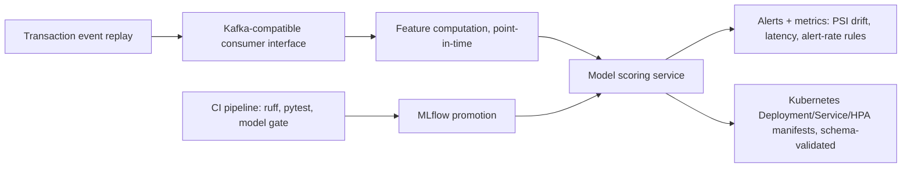

# Fraud Scoring MLOps - Streaming Scoring, CI Model Gates, Monitoring Alerts, and Kubernetes Manifests

`fraud-mlops-cicd` · new project · estimated build effort: 4 h

## Problem

Extends the verified fraud-scoring service (fraud-risk-mlops) with the production-engineering layer an ML platform team owns: an event-streaming scoring path (Kafka-compatible consumer interface with an in-process broker for local runs), a CI pipeline definition that runs lint, tests, and a model-quality gate before promotion, monitoring with drift and latency alert rules, and Kubernetes deployment manifests validated against the Kubernetes schema. All previous tests and metrics must still pass.

## Target jobs and skills

- **bet365 — Machine Learning Engineer** (`60fd0bee3d22`): covers 88% of the JD's weighted top skills (Python, MLOps, Docker, Kubernetes, CI/CD, Model Monitoring, Kafka, Git, FastAPI)

Skills/tools this project demonstrates: Python, MLOps, Model Monitoring, CI/CD, Kafka, Kubernetes, Docker, FastAPI, MLflow, Git, Anomaly Detection, Classification, Gradient Boosting

## Data

- **Dataset:** Same simulated card-transaction stream as fraud-risk-mlops — projects/library/fraud-risk-mlops
- **License/terms:** Generated in code (project-owned)
- **Size used:** 3,000,000 simulated transactions (parent splits reused)
- **Plan:** Streaming replay uses the parent project's out-of-time test weeks in event-time order.

## Architecture

## Tech stack

Python 3.11, FastAPI, MLflow, LightGBM, kafka-python interface + in-process broker, Prometheus client, kubernetes-validate, ruff, pytest

## Deliverables

- streaming/ package: consumer interface, event-time replay, scoring loop with exactly-once bookkeeping in tests
- CI workflow file (GitHub Actions YAML) plus a local runner in run.py that executes the same steps
- Model-quality gate that blocks promotion if PR-AUC or recall@1% drops below the current production model
- Monitoring: Prometheus metrics, drift/latency/alert-rate rules with tests; Kubernetes manifests validated by schema; Dockerfile linted

## Success criteria (all must hold on a from-scratch `python run.py`)

| Metric | Threshold | How it is measured |
|---|---|---|
| Streaming vs. batch parity | streamed scores identical to batch scores for all test-week events | replay test |
| Streaming throughput on CPU | >= 2,000 events/s through the scoring loop | timed replay |
| Model gate | gate blocks a deliberately degraded model and passes the production model | pytest |
| Drift alert | fires only in the week with the injected fraud-pattern shift (as in the parent) | replay |
| Manifests | all Kubernetes manifests validate against the schema for v1.29 | kubernetes-validate |
| Parent project | all previous tests pass and headline metrics reproduce within 2% | re-run |
| Test coverage of src/ and streaming/ | >= 75% | pytest --cov |

## Evaluation artifacts (required; the evaluator recomputes metrics from these)

- Keep producing every parent artifact (results/metrics.json, test_predictions.csv, val_predictions.csv, loadtest_latencies.csv, drift_weekly.csv) from the same run.py
- results/stream_vs_batch.csv with columns event_id, batch_score, stream_score - every out-of-time test-week event
- results/stream_throughput.json with keys events, seconds
- results/gate_results.json with keys production and degraded, each containing at least passed (bool) and the gate metrics
- results/stream_drift_weekly.csv with columns week, psi, alert (0/1), shifted (0/1)
- results/manifest_validation.json mapping each manifest file to {valid: bool, kind: str}; must include Deployment, Service, HorizontalPodAutoscaler

## Baseline

The parent project's batch scoring path.

## Constraints

- Runs on Windows with `python run.py` from a fresh virtualenv; no make, shell scripts, paid APIs, or accounts.
- CPU-only by default (an optional `--device cuda` flag is fine); peak RAM <= 3 GB; total downloads <= 1.5 GB.
- PyTorch (if used) pinned to the CPU wheel via `--extra-index-url https://download.pytorch.org/whl/cpu`.
- Fixed random seeds; every reported number is written by code to results/metrics.json (never typed by hand).
- Test split is created once, saved, and never used for training, tuning, or threshold selection.
- Data download is scripted (Python requests), cached under data/, and verified by checksum or row count.
- Docker, Kubernetes clusters, Kafka brokers, and GCP are not available: manifests and the Dockerfile are validated statically, the broker is in-process; never claim a cluster, container, or real Kafka deployment.

## Draft resume bullets (placeholders are filled only with reproduced metrics)

- Added a streaming scoring path to a fraud model with batch-identical scores at [EPS] events/s and a drift alert that fired only on the shifted week
- Wrote a CI pipeline with lint, tests, and a model-quality gate that blocks promotion when PR-AUC or recall@1% regresses
- Defined Kubernetes Deployment/Service/HPA manifests validated against the schema, with Prometheus latency and drift alert rules
