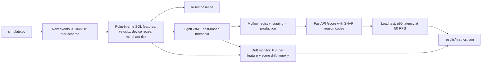

# Real-Time Payment Fraud Scoring with Feature Pipelines, Model Registry, and Drift Monitoring

`fraud-risk-mlops` · new project · estimated build effort: 5 h

## Problem

Fintech risk teams need fraud models that are fast to serve, explainable, and monitored after launch. This project simulates payment transactions with entity IDs (customers, cards, devices, merchants) and injected fraud patterns (card testing, account takeover, mule merchants). It builds an ETL plus point-in-time feature pipeline in SQL (velocity, device reuse, merchant risk), trains a LightGBM model against a rules baseline, and picks the decision threshold by expected cost. The model is registered in MLflow and served through FastAPI. A drift monitor (PSI and score-distribution checks) runs over simulated future weeks with an injected shift.

## Target jobs and skills

- **BABYLIST — Staff Machine Learning Engineer** (`70ade98eb887`): covers 44% of the JD's weighted top skills (Python, MLOps, Model Monitoring, Gradient Boosting, Feature Engineering)
- **DraftKings — Senior Machine Learning Engineer, FinTech** (`ada7c088467b`): covers 95% of the JD's weighted top skills (Python, SQL, ETL, Feature Engineering, MLOps, Model Monitoring, Git, Data Warehousing, Anomaly Detection, Classification, FastAPI)
- **Brex — Data Scientist II, Applied ML** (`1feefa5b66da`): covers 65% of the JD's weighted top skills (Python, SQL, FastAPI, MLOps, Anomaly Detection, Classification, Gradient Boosting)

Skills/tools this project demonstrates: Python, SQL, ETL, Feature Engineering, Classification, Gradient Boosting, LightGBM, Anomaly Detection, MLOps, MLflow, FastAPI, Model Monitoring, Data Warehousing, Model Evaluation, Git

## Data

- **Dataset:** Simulated payment transactions (generator included; design follows the published PaySim/BankSim approach) — n/a (generated locally by src/simulate.py)
- **License/terms:** MIT (own code)
- **Size used:** 3M transactions over 12 weeks, ~150k customers, ~1.2% fraud
- **Plan:** Out-of-time split (weeks 1-8 train, 9 validation, 10-12 test/monitoring); week 11 gets an injected fraud-pattern shift.

## Architecture

## Tech stack

Python 3.11, DuckDB, LightGBM, scikit-learn, MLflow, FastAPI, uvicorn, httpx, SHAP, pytest

## Deliverables

- Simulator with documented fraud patterns and tests of its invariants
- Star-schema warehouse and point-in-time-correct feature SQL (tests prove there is no future leakage)
- LightGBM model, cost-based threshold, MLflow registry with a promotion step
- FastAPI scoring service with reason codes, plus a load-test script
- Drift monitoring job with alert rules and a weekly report

## Success criteria (all must hold on a from-scratch `python run.py`)

| Metric | Threshold | How it is measured |
|---|---|---|
| Test PR-AUC (weeks 10-12) | >= 0.60 and >= 1.5x the rules baseline | out-of-time test |
| Recall at 1% alert rate | >= 0.70 | top 1% of scores per day |
| API p95 latency at 50 RPS | < 50 ms (local) | load-test script |
| Drift detection | alarm fires in week 11 (injected shift) and not in weeks 10 or 12 | PSI > 0.2 rule |
| Point-in-time correctness | 0 features computed from events after the scored transaction | dedicated tests |
| Test coverage of src/ | >= 80% | pytest --cov |

## Baseline

Hand-written rules (amount and velocity thresholds, new device + high amount) tuned on training weeks.

## Constraints

- Runs on Windows with `python run.py` from a fresh virtualenv; no make, shell scripts, paid APIs, or accounts.
- CPU-only by default (an optional `--device cuda` flag is fine); peak RAM <= 3 GB; total downloads <= 1.5 GB.
- PyTorch (if used) pinned to the CPU wheel via `--extra-index-url https://download.pytorch.org/whl/cpu`.
- Fixed random seeds; every reported number is written by code to results/metrics.json (never typed by hand).
- Test split is created once, saved, and never used for training, tuning, or threshold selection.
- Data download is scripted (Python requests), cached under data/, and verified by checksum or row count.
- README and bullets state that the transactions are simulated.

## Draft resume bullets (placeholders are filled only with reproduced metrics)

- Built a point-in-time-correct SQL feature pipeline and LightGBM fraud model on 3M simulated transactions, reaching [PRAUC] PR-AUC ([LIFT]x a rules baseline) on out-of-time weeks
- Served the model through FastAPI with SHAP reason codes at [P95_MS] ms p95 latency under 50 RPS, with versions promoted through an MLflow model registry
- Added PSI-based drift monitoring that flagged an injected fraud-pattern shift in the week it began without false alarms in stable weeks
